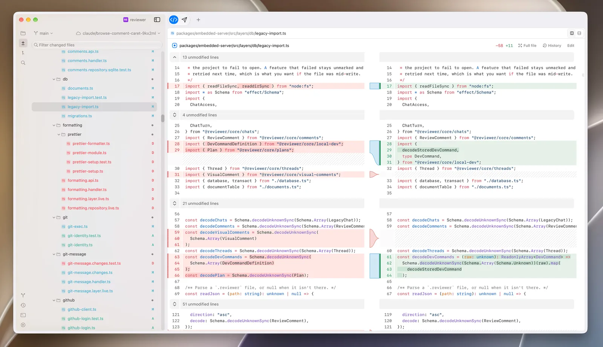
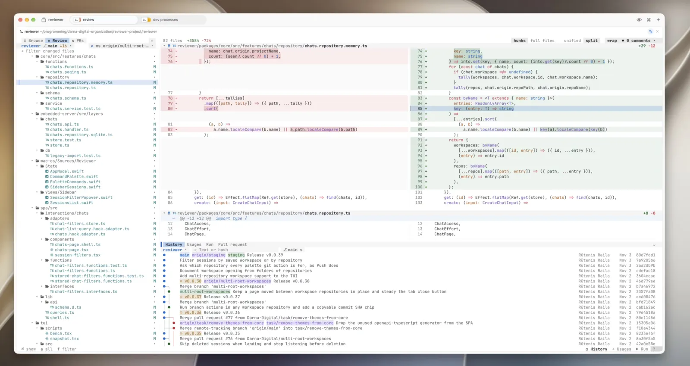

<div align="center">

<picture>
  <source media="(prefers-color-scheme: dark)" srcset="docs/icon-dark.svg">
  
</picture>

# Reviewer

Reviewer is an agentic development environment for engineers who deeply care about the quality of their work.

[](https://github.com/Darna-Digital/reviewer/releases/latest)
[](https://github.com/Darna-Digital/reviewer/releases)
[](https://github.com/Darna-Digital/reviewer/actions/workflows/release.yml)
[](LICENSE)
[](CONTRIBUTING.md)

[Website](https://reviewer.sh) · [Docs](https://reviewer.sh/docs) · [Changelog](https://reviewer.sh/changelog) · [Report a bug](https://github.com/Darna-Digital/reviewer/issues/new?template=bug_report.yml) · [Request a feature](https://github.com/Darna-Digital/reviewer/issues/new?template=feature_request.yml)

</div>

<br>

<table>
  <tr>
    <th>Mac app</th>
    <th>Terminal app</th>
  </tr>
  <tr>
    <td width="50%">
      <picture>
        <source media="(prefers-color-scheme: dark)" srcset="docs/screenshots/split-diff-dark.webp">
        
      </picture>
    </td>
    <td width="50%">
      <picture>
        <source media="(prefers-color-scheme: dark)" srcset="docs/screenshots/tui-hero-dark.webp">
        
      </picture>
    </td>
  </tr>
</table>

Reviewer shows the changes in a local Git repository: uncommitted work, a
branch, a commit or a GitHub pull request. You leave comments on lines, and an
agent picks them up and fixes them. Everything runs on your machine; comments
are kept in a local database.

- **The Mac app** is a native SwiftUI/AppKit app with Claude Code and Codex
  sessions built in. It needs Apple silicon and macOS 26 or later.
- **The terminal app** runs on macOS and Linux, on arm64 and x64, including on
  a server over SSH.

Both apps share the same comments, so you can use either or both.

## Contents

- [Install](#install)
- [Resolve review comments with any agent](#resolve-review-comments-with-any-agent)
- [Privacy](#privacy)
- [Development](#development)
- [Contributing](#contributing)
- [License](#license)

## Install

**The Mac app**

1. Download the latest `Reviewer-<version>-arm64.dmg` from
   [Releases](https://github.com/Darna-Digital/reviewer/releases/latest) or
   [reviewer.sh/download](https://reviewer.sh/download).
2. Open the disk image and drag **Reviewer** into **Applications**.

Every release is signed with a Developer ID and notarized by Apple, and the app
offers new versions as they ship.

**The terminal app**

```bash
curl -fsSL https://reviewer.sh/install | bash
```

It installs into `~/.reviewer` along with the Node.js it runs on. Run
`reviewer` in a repository to open it, or `reviewer --help` for the options.
`reviewer upgrade` updates it. See [packages/tui](packages/tui#readme) for
building it from source.

## Resolve review comments with any agent

Comments you leave in Reviewer can be handed to any coding agent (Claude Code,
Codex, Cursor, OpenCode, …) through the
[`resolve-reviewer-comments`](skills/resolve-reviewer-comments/SKILL.md) skill.
It reads the repository's comments from Reviewer's local API server, implements
them and resolves them one by one.

```bash
npx skills add Darna-Digital/reviewer --skill resolve-reviewer-comments
```

Then, with Reviewer running, ask the agent to "resolve my reviewer comments".

## Privacy

Reviewer runs on your machine, and your code never leaves it through us. The
one thing the apps tell us is that they were used today, so we know how many
people run Reviewer and on which versions.

Both apps already check for updates. The check goes to reviewer.sh, which
redirects it to the latest GitHub release. The first check of each day also
carries:

| Field | Example |
| --- | --- |
| App | `mac` or `tui` |
| Version, from the user-agent | `0.0.42` |
| OS: macOS major version, or `linux` / `darwin` | `26` |
| Your local date | `2026-11-05` |
| First counted day of this week / month (yes or no) | `w=1`, `m=0` |
| First counted day ever (yes or no) | `new=0` |
| Install month | `2026-10` |

Cloudflare adds the country. Later checks that day carry nothing.

There's no install ID, and no IP address is stored. Nothing about your code,
repositories, paths, accounts or what you do in the app is ever sent. Each app
works out the yes-or-no answers itself from the dates it last counted, so two
days from the same install can't be linked to each other.

The checks are kept for three months in Cloudflare Workers Analytics Engine,
then only as daily totals in Cloudflare D1. The code is
[packages/www/src/lib/usage.ts](packages/www/src/lib/usage.ts).

**To turn it off** (updates keep working):

- **Mac app:** Settings (⌘,) → Privacy → turn off **Share anonymous usage
  counts**.
- **Terminal app:** run **Turn usage counting off / on** from the command palette,
  or set `REVIEWER_DISABLE_ANALYTICS=1` or `DO_NOT_TRACK=1`.

Development builds never count. The full policy, including the
website, is at [reviewer.sh/privacy](https://reviewer.sh/privacy). Questions
about your data go to
[rutenis@darnadigital.com](mailto:rutenis@darnadigital.com).

## Development

Reviewer is a pnpm monorepo. The Mac app is a native SwiftUI/AppKit shell that
hosts parts of a React web app as views inside its own layout. The terminal app
is drawn with OpenTUI. Both talk to the same local API server, which does the
git and filesystem work.

| Package                                                | What it is                                                                      |
| ------------------------------------------------------ | ------------------------------------------------------------------------------- |
| [`packages/mac-os`](packages/mac-os)                   | The macOS app — a Swift package (SwiftUI + AppKit), bundled into `Reviewer.app` |
| [`packages/spa`](packages/spa)                         | The React web app whose surfaces the shell hosts                                |
| [`packages/embedded-server`](packages/embedded-server) | The local API server the app runs beside it (Effect, git/filesystem-backed)     |
| [`packages/core`](packages/core)                       | Feature schemas and services shared by the server and the SPA                   |
| [`packages/themes`](packages/themes)                   | The theme catalog and Shiki highlighting, behind core's `ThemeLibrary` port     |
| [`packages/tui`](packages/tui)                         | Reviewer in a terminal — diffs, branches, history and comments (OpenTUI, Bun)   |
| [`packages/www`](packages/www)                         | [reviewer.sh](https://reviewer.sh), on Cloudflare Workers                       |
| [`packages/brand`](packages/brand)                     | The brand studio that draws and exports the logo and icons                      |
| [`packages/lint`](packages/lint)                       | Shared ESLint and Prettier config                                               |

### Prerequisites

- macOS 26 on Apple silicon, with **Xcode 26**
- Xcode's Metal toolchain: `xcodebuild -downloadComponent MetalToolchain`
- **Node.js** (current LTS) and **pnpm** 11 (`corepack enable`)
- **Bun** 1.3+, for the terminal UI only

### Run it locally

```bash
pnpm install
pnpm dev      # API server + SPA, in one terminal
pnpm dev:mac  # build and open the debug app, in another
```

| Command             | Does                                               |
| ------------------- | -------------------------------------------------- |
| `pnpm dev`          | API server + SPA in watch mode                     |
| `pnpm dev:mac`      | Build and open the debug `Reviewer.app`            |
| `pnpm dev:www`      | The reviewer.sh site                               |
| `pnpm tui`          | The terminal UI, on the repository you are in      |
| `pnpm install:tui`  | Build the terminal UI and install `reviewer`       |
| `pnpm build:mac`    | A release build of `Reviewer.app`, as CI builds it |
| `pnpm lint`         | ESLint across the workspace                        |
| `pnpm format:check` | Prettier across the workspace                      |
| `pnpm typecheck`    | TypeScript across the workspace                    |

### Releasing

Releases are built, signed, notarized and published by GitHub Actions when a
version bump lands on `main` — see [RELEASING.md](RELEASING.md).

## Contributing

Bug reports, ideas and pull requests are all welcome. Read
[CONTRIBUTING.md](CONTRIBUTING.md) to get started, and please follow the
[Code of Conduct](CODE_OF_CONDUCT.md). Security issues go through
[SECURITY.md](SECURITY.md), not public issues.

## License

Reviewer is released under the [MIT License](LICENSE).

<div align="center">
<br>
<sub>Made by <a href="https://darnadigital.com">Darna Digital</a>.</sub>
</div>
