<div align="center">

<picture>
  <source media="(prefers-color-scheme: dark)" srcset="docs/icon-dark.svg">
  
</picture>

# Reviewer

**Focused system for building software with agents.**

Works with the agents you already use: Claude Code, Codex and any agent that runs skills.<br>
Read the change, comment on what's wrong, hand it back and check the fix.

[](https://github.com/Darna-Digital/reviewer/releases/latest)
[](https://github.com/Darna-Digital/reviewer/releases)
[](https://github.com/Darna-Digital/reviewer/actions/workflows/release.yml)
[](LICENSE)
<br>
[](https://reviewer.sh/mac)
[](https://reviewer.sh/terminal)
[](https://reviewer.sh)
[](packages/mac-os)
[](packages)
[](CONTRIBUTING.md)

[**Download**](https://reviewer.sh/download) · [Website](https://reviewer.sh) · [Docs](https://reviewer.sh/docs) · [Changelog](https://reviewer.sh/changelog) · [Report a bug](https://github.com/Darna-Digital/reviewer/issues/new?template=bug_report.yml) · [Request a feature](https://github.com/Darna-Digital/reviewer/issues/new?template=feature_request.yml)

</div>

<br>

<picture>
  <source media="(prefers-color-scheme: dark)" srcset="docs/screenshots/split-diff-dark.webp">
  
</picture>

## Contents

- [Choose where you work](#choose-where-you-work)
- [The Mac app](#the-mac-app)
- [The terminal app](#the-terminal-app)
- [Reviewer Cloud](#reviewer-cloud)
- [Install](#install)
- [Resolve review comments with any agent](#resolve-review-comments-with-any-agent)
- [Questions](#questions)
- [Development](#development)
- [Contributing](#contributing)
- [License](#license)

## Choose where you work

|                                           |                                                                                                        |
| ----------------------------------------- | ------------------------------------------------------------------------------------------------------ |
| [**The Mac app**](#the-mac-app)           | The change, your comments and your Claude Code and Codex sessions in one window. Free and open source. |
| [**The terminal app**](#the-terminal-app) | The same review from the keyboard, over SSH or on Linux. Free and open source.                         |
| [**Reviewer Cloud**](#reviewer-cloud)     | Our paid service, in the works. [Join the waitlist](https://reviewer.sh/cloud).                        |

## The Mac app

### Review diffs your way

Toggle between split and unified views. When a hunk isn't enough context, open
the whole file.

<table>
  <tr>
    <th>Horizontal</th>
    <th>Vertical</th>
  </tr>
  <tr>
    <td width="50%">
      <picture>
        <source media="(prefers-color-scheme: dark)" srcset="docs/screenshots/diff-split-dark.webp">
        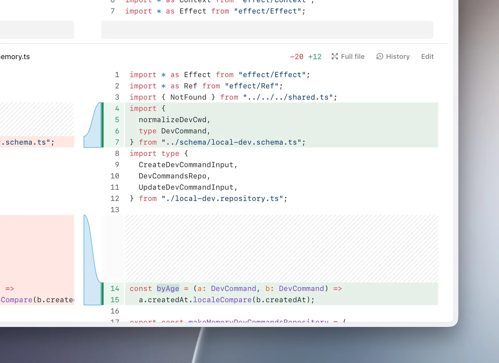
      </picture>
    </td>
    <td width="50%">
      <picture>
        <source media="(prefers-color-scheme: dark)" srcset="docs/screenshots/diff-stacked-dark.webp">
        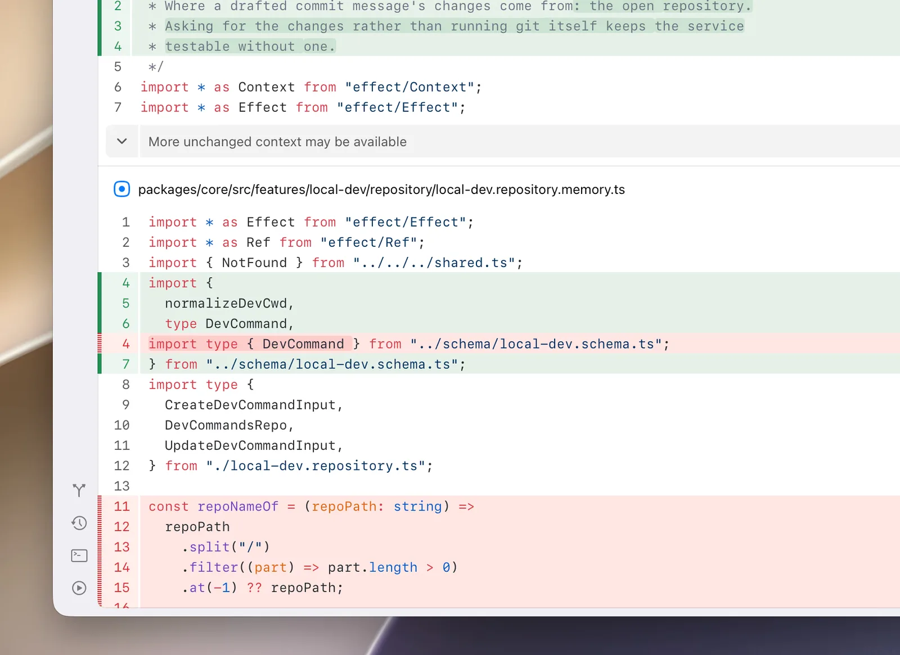
      </picture>
    </td>
  </tr>
</table>

### Work with Claude Code and Codex from the same interface

Use popular harnesses directly in Reviewer, or use
[skills](#resolve-review-comments-with-any-agent) to connect to any harness you
have on your machine.

<picture>
  <source media="(prefers-color-scheme: dark)" srcset="docs/screenshots/agent-models-dark.webp">
  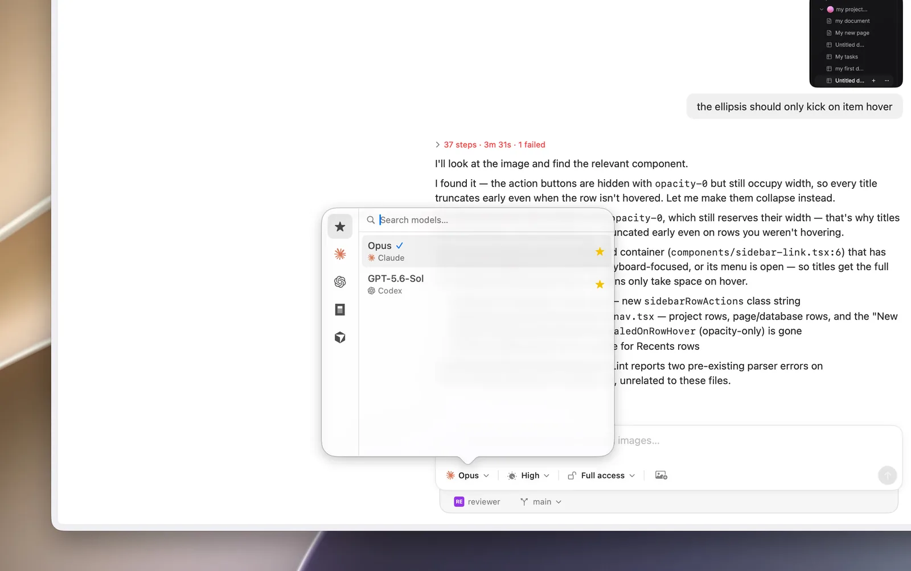
</picture>

### Comment, then hand it off

Leave a comment on any line, then assign it to an agent to pick up and fix.

<picture>
  <source media="(prefers-color-scheme: dark)" srcset="docs/screenshots/comment-assign-dark.webp">
  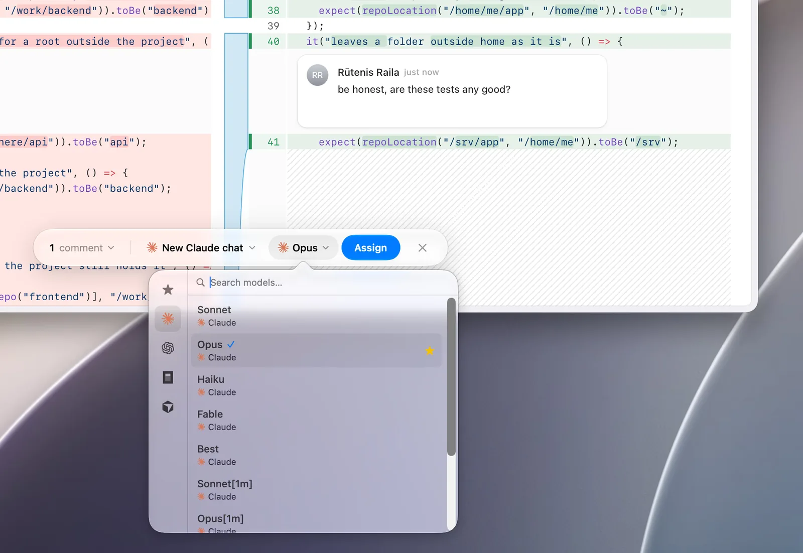
</picture>

### Run your services in one click

Set up your local services once from a macOS widget and start them with a
single click. If it runs in a terminal, it runs here.

<picture>
  <source media="(prefers-color-scheme: dark)" srcset="docs/screenshots/run-services-dark.webp">
  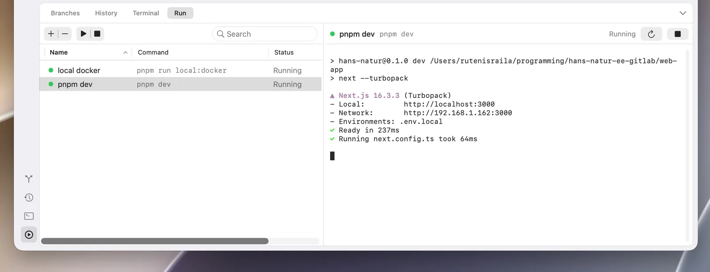
</picture>

### Intuitive Git integration

Create new branches and let Reviewer write the commit message from what
changed.

<picture>
  <source media="(prefers-color-scheme: dark)" srcset="docs/screenshots/branch-picker-dark.webp">
  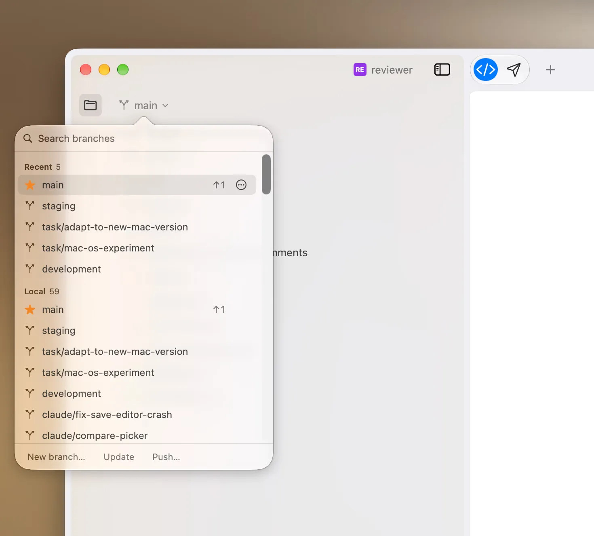
</picture>

### Know what changed, and when

Filter the history by author, date or branch. Click any entry to see what
changed and when, or open a single file's history to follow how it got to where
it is.

<picture>
  <source media="(prefers-color-scheme: dark)" srcset="docs/screenshots/history-dark.webp">
  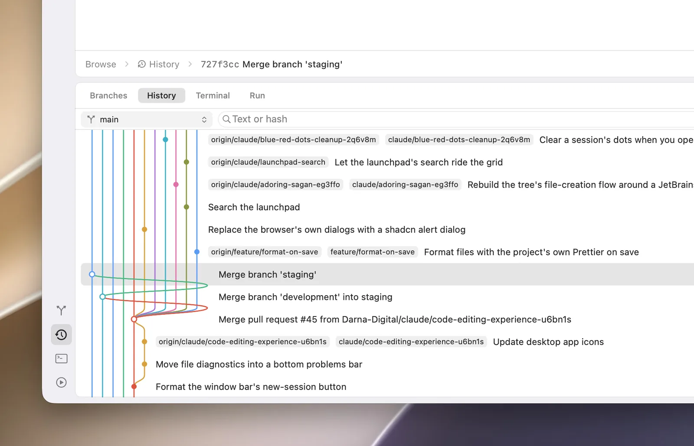
</picture>

### Follow a code symbol to its source

Language server protocol integration for TypeScript, Swift, Ruby and PHP. Hover
a symbol for its signature and docs, or find every usage of it across the
codebase. In a Laravel app, `view()`, `config()`, `env()`, `__()`, Blade
includes and `<x-…>` components link to the files they name, and PHPStan's
findings show beside the language server's when the app runs it. No PHP server
installed? Settings → Languages installs intelephense for you.

<picture>
  <source media="(prefers-color-scheme: dark)" srcset="docs/screenshots/find-symbol-dark.webp">
  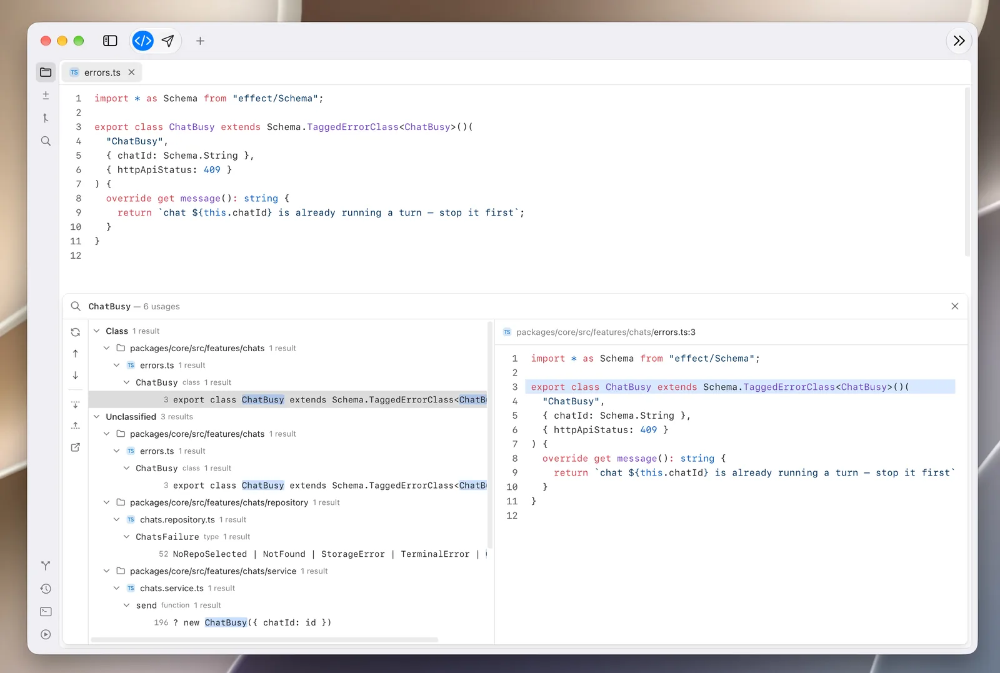
</picture>

### And the rest

- **Terminal**: a built-in terminal for ad hoc work, right next to the code.
- **Light and dark**: follows your Mac, or pick the appearance you prefer.
- **Themes**: Shiki and Pierre themes to make the environment your own.
- **Native to the Mac**: built for Apple silicon, macOS 26 and later.

## The terminal app

Review a branch without leaving the terminal. The terminal app reads the same
changes and comments as the Mac app. Run it over SSH, in a tmux pane next to
your agent, or on Linux.

```bash
curl -fsSL https://reviewer.sh/install | bash
```

<picture>
  <source media="(prefers-color-scheme: dark)" srcset="docs/screenshots/tui-hero-dark.webp">
  
</picture>

### Comment on the line that's wrong

Press <kbd>c</kbd> on any line and write what's wrong. The comment shows up in
the Mac app's diff too.

<picture>
  <source media="(prefers-color-scheme: dark)" srcset="docs/screenshots/tui-comment-dark.webp">
  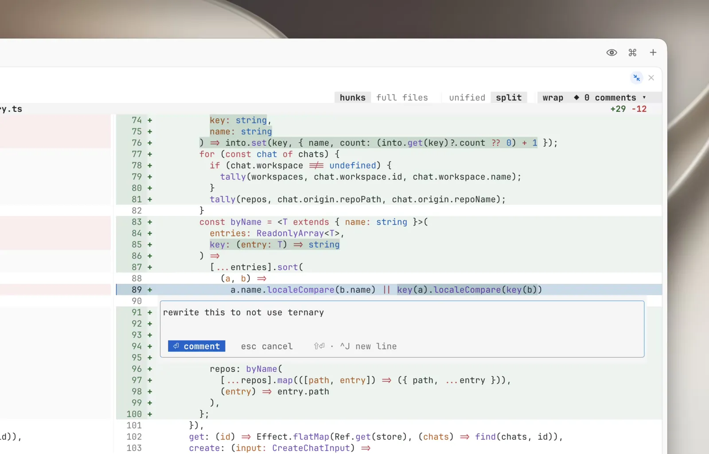
</picture>

### Side by side or top to bottom

<kbd>s</kbd> switches layouts. Hunks or full files, wrapped or not, with the
changed files beside the diff.

<table>
  <tr>
    <th>Top to bottom</th>
    <th>Side by side</th>
  </tr>
  <tr>
    <td width="50%">
      <picture>
        <source media="(prefers-color-scheme: dark)" srcset="docs/screenshots/tui-unified-dark.webp">
        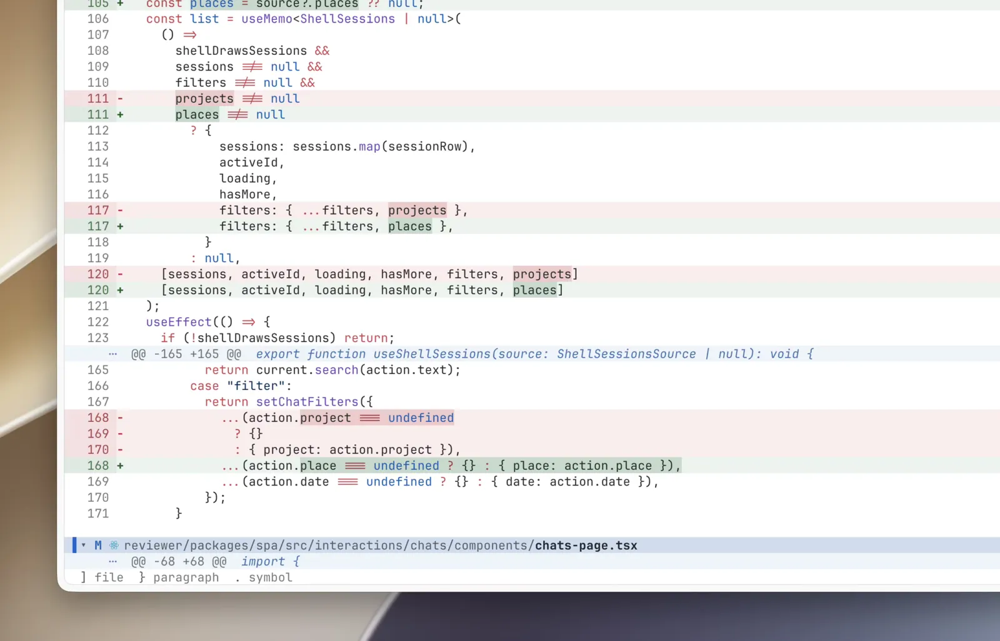
      </picture>
    </td>
    <td width="50%">
      <picture>
        <source media="(prefers-color-scheme: dark)" srcset="docs/screenshots/tui-split-dark.webp">
        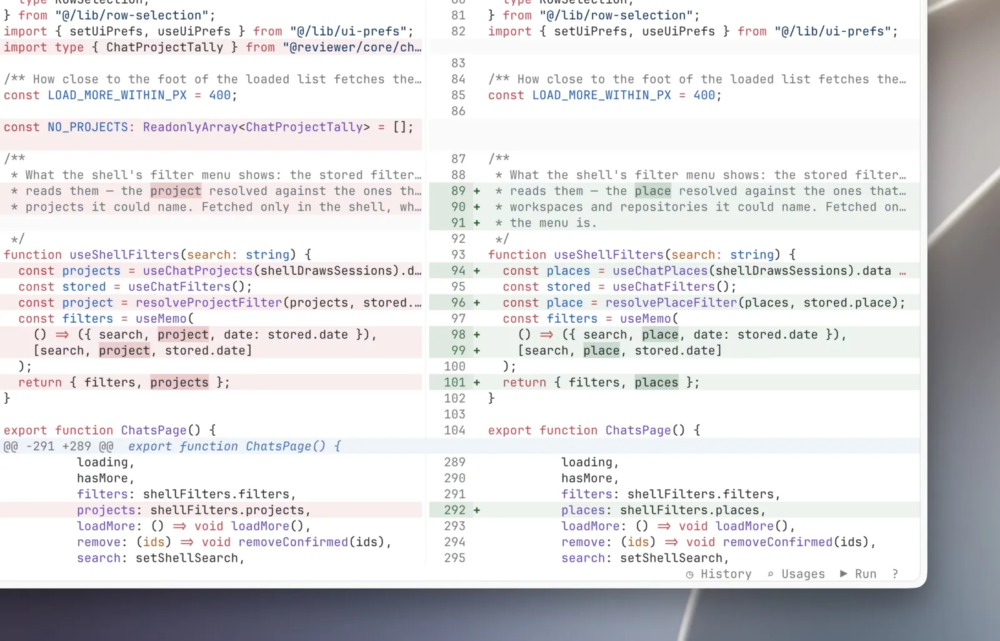
      </picture>
    </td>
  </tr>
</table>

### See what changed, and when

The History pane lists the branch's commits. Open one to read it like any other
change.

<picture>
  <source media="(prefers-color-scheme: dark)" srcset="docs/screenshots/tui-history-dark.webp">
  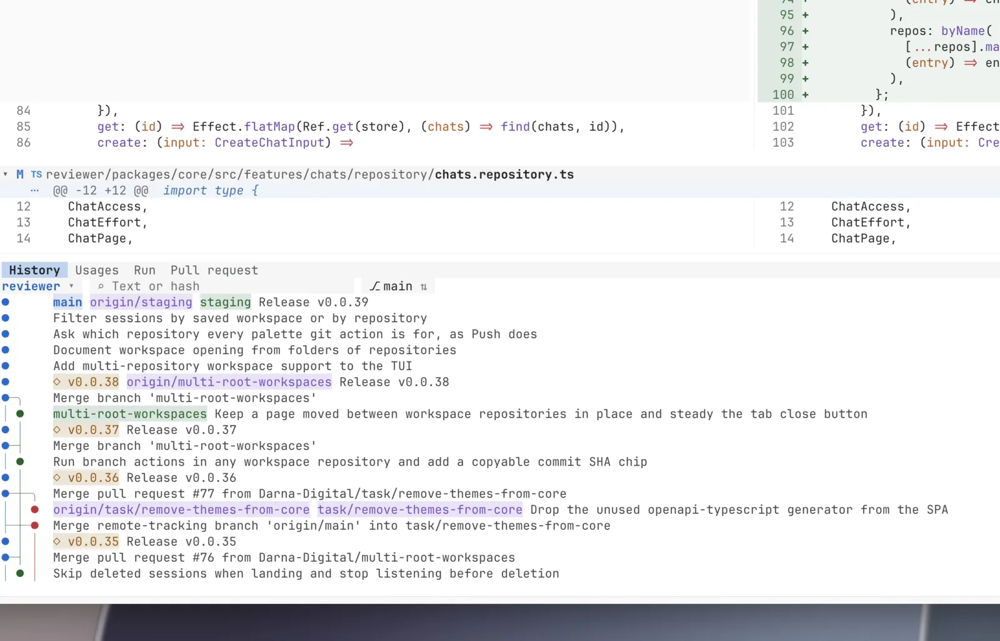
</picture>

### Every action is a keystroke away

<kbd>⌘K</kbd> opens the command palette: go to file, search in files, switch
branch and every Git action. <kbd>u</kbd> finds every usage of the symbol under
the cursor, <kbd>⌃T</kbd> opens the theme picker and <kbd>?</kbd> lists every
key.

### One command for whatever you're reviewing

| Command                          | Opens                             |
| -------------------------------- | --------------------------------- |
| `reviewer`                       | The repository you're in          |
| `reviewer --against main`        | The branch against main           |
| `reviewer --commit 3f2a9c1`      | A single commit                   |
| `reviewer --pr 42`               | A GitHub pull request             |
| `reviewer ~/code/web ~/code/api` | Several repositories side by side |

### And the rest

- **Shared with the Mac app**: a comment you leave here shows up in the Mac
  app, and the other way round.
- **Doesn't need the Mac app**: the install brings the Reviewer server and the
  Node.js it runs on, so it works the same on Linux.
- **Updates itself**: it checks for a new release at launch. Run update
  Reviewer from <kbd>⌘K</kbd>, or `reviewer upgrade` from the shell.
- **Workspaces**: open several repositories side by side, or a saved workspace
  with `reviewer -w`.

## Reviewer Cloud

Reviewer Cloud is going to focus on making you and your team more productive
through isolated cloud sandboxes. It's the paid part of Reviewer.
[Join the waitlist](https://reviewer.sh/cloud) to hear when it opens.

## Install

**The Mac app**

1. Download the latest `Reviewer-<version>-arm64.dmg` from
   [reviewer.sh/download](https://reviewer.sh/download) or
   [Releases](https://github.com/Darna-Digital/reviewer/releases/latest).
2. Open the disk image and drag **Reviewer** into **Applications**.

It needs an Apple silicon Mac on macOS 26 or later. Every release is signed
with a Developer ID and notarized by Apple, and the app offers new versions as
they ship.

**The terminal app**

```bash
curl -fsSL https://reviewer.sh/install | bash
```

It runs on macOS and Linux, on arm64 and x64, and installs into `~/.reviewer`.
See [packages/tui](packages/tui#readme) for building it from source.

## Resolve review comments with any agent

Comments you leave in Reviewer can be handed to any coding agent (Claude Code,
Codex, Cursor, OpenCode, …) through the
[`resolve-reviewer-comments`](skills/resolve-reviewer-comments/SKILL.md) skill.
It reads the repository's comments from Reviewer's local API server, implements
them and resolves them one by one.

```bash
npx skills add Darna-Digital/reviewer --skill resolve-reviewer-comments
```

Then, with Reviewer running, ask the agent to "resolve my reviewer comments".

## Questions

**Is it free?** The Mac app and the terminal app are free and MIT-licensed, and
they stay that way. Reviewer Cloud will be a paid service.

**Does my code leave my machine?** Reviewer works locally on your machine. It
orchestrates GitHub and your locally installed agents, so your code never
reaches Reviewer's servers.

**Which agents work with it?** Claude Code and Codex run inside the Mac app.
Any other agent can pick up your comments with the
[`resolve-reviewer-comments`](skills/resolve-reviewer-comments/SKILL.md) skill.

**Who isn't it for?** If you run 100 parallel agents and don't check their
work, then Reviewer is not for you. Reviewer is designed for engineers who care
about their work deeply and verify it before shipping.

## Development

Reviewer is a pnpm monorepo. The Mac app is a native SwiftUI/AppKit shell that
hosts parts of a React web app as views inside its own layout. The terminal app
is drawn with OpenTUI. Both talk to the same local API server, which does the
git and filesystem work.

| Package                                                | What it is                                                                      |
| ------------------------------------------------------ | ------------------------------------------------------------------------------- |
| [`packages/mac-os`](packages/mac-os)                   | The macOS app — a Swift package (SwiftUI + AppKit), bundled into `Reviewer.app` |
| [`packages/spa`](packages/spa)                         | The React web app whose surfaces the shell hosts                                |
| [`packages/embedded-server`](packages/embedded-server) | The local API server the app runs beside it (Effect, git/filesystem-backed)     |
| [`packages/core`](packages/core)                       | Feature schemas and services shared by the server and the SPA                   |
| [`packages/themes`](packages/themes)                   | The theme catalog and Shiki highlighting, behind core's `ThemeLibrary` port     |
| [`packages/tui`](packages/tui)                         | Reviewer in a terminal — diffs, branches, history and comments (OpenTUI, Bun)   |
| [`packages/www`](packages/www)                         | [reviewer.sh](https://reviewer.sh), on Cloudflare Workers                       |
| [`packages/brand`](packages/brand)                     | The brand studio that draws and exports the logo and icons                      |
| [`packages/lint`](packages/lint)                       | Shared ESLint and Prettier config                                               |

### Prerequisites

- macOS 26 on Apple silicon, with **Xcode 26**
- Xcode's Metal toolchain: `xcodebuild -downloadComponent MetalToolchain`
- **Node.js** (current LTS) and **pnpm** 11 (`corepack enable`)
- **Bun** 1.3+, for the terminal UI only

### Run it locally

```bash
pnpm install
pnpm dev      # API server + SPA, in one terminal
pnpm dev:mac  # build and open the debug app, in another
```

| Command             | Does                                               |
| ------------------- | -------------------------------------------------- |
| `pnpm dev`          | API server + SPA in watch mode                     |
| `pnpm dev:mac`      | Build and open the debug `Reviewer.app`            |
| `pnpm dev:www`      | The reviewer.sh site                               |
| `pnpm tui`          | The terminal UI, on the repository you are in      |
| `pnpm install:tui`  | Build the terminal UI and install `reviewer`       |
| `pnpm build:mac`    | A release build of `Reviewer.app`, as CI builds it |
| `pnpm lint`         | ESLint across the workspace                        |
| `pnpm format:check` | Prettier across the workspace                      |
| `pnpm typecheck`    | TypeScript across the workspace                    |

### Releasing

Releases are built, signed, notarized and published by GitHub Actions when a
version bump lands on `main` — see [RELEASING.md](RELEASING.md).

## Contributing

Bug reports, ideas and pull requests are all welcome. Read
[CONTRIBUTING.md](CONTRIBUTING.md) to get started, and please follow the
[Code of Conduct](CODE_OF_CONDUCT.md). Security issues go through
[SECURITY.md](SECURITY.md), not public issues.

## License

Reviewer is released under the [MIT License](LICENSE).

<div align="center">
<br>
<sub>Made by <a href="https://darnadigital.com">Darna Digital</a>.</sub>
</div>
